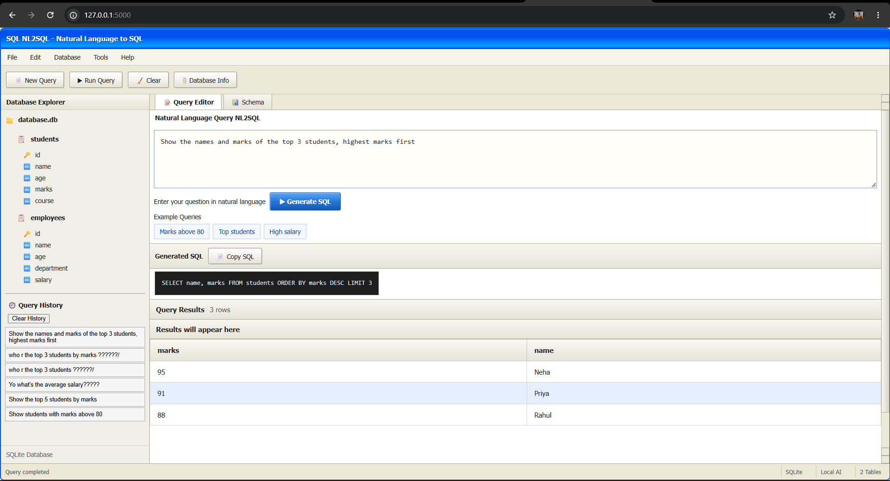

# NL2SQL
### Natural Language to SQL

NL2SQL is a project I built to explore how natural language can make working with databases easier.

Instead of writing SQL queries manually, users can ask questions in plain English and get the corresponding SQL query along with the results.

The application uses a local AI model through Ollama to generate SQL queries from natural language. I also wanted the interface to feel different from the usual dashboard projects, so I went with a classic Windows XP-inspired design.

## Preview



## Features

- **Natural Language to SQL** — Convert everyday questions into SQL queries.
- **Local AI** — Generate SQL using Qwen 2.5 Coder through Ollama.
- **Database Explorer** — Explore database tables and columns.
- **SQL Preview** — View the generated SQL before execution.
- **Query Results** — Display query results in a table.
- **Query History** — Access previous queries from the browser.
- **Copy SQL** — Copy generated queries for further use.
- **SQL Safeguards** — Restrict database execution to read-oriented queries.
- **Classic Interface** — A Windows XP-inspired application design.

## Built With

- Python
- Flask
- SQLite
- Ollama
- Qwen 2.5 Coder 3B
- HTML
- CSS
- JavaScript

## How It Works

1. The user enters a question in natural language.
2. The Flask backend receives the question.
3. The application reads the database schema.
4. The question and schema are sent to the local Qwen model through Ollama.
5. The generated SQL is checked before execution.
6. The query is executed against the SQLite database.
7. The SQL and results are displayed in the interface.

## Project Structure

```text
NL2SQL/
├── app.py                 # Flask application and API routes
├── schema_reader.py       # Reads database tables and columns
├── database.db            # Sample SQLite database
├── requirements.txt       # Python dependencies
├── templates/
│   └── index.html         # Main application interface
├── static/
│   ├── style.css          # Application styling
│   └── script.js          # Frontend logic and interactions
├── Screenshots/
│   └── nl2sql.png         # Project screenshot
└── README.md               # Project documentation
```

## Getting Started

### Requirements

You'll need the following installed:

- Python
- Git
- Ollama

### 1. Clone the repository

```bash
git clone https://github.com/vaibhavurf/NL2SQL.git
cd NL2SQL
```

### 2. Create a virtual environment

```bash
python -m venv .venv
```

Activate it using PowerShell:

```powershell
.\.venv\Scripts\Activate.ps1
```

### 3. Install dependencies

```bash
pip install -r requirements.txt
```

### 4. Download the model

```bash
ollama pull qwen2.5-coder:3b
```

Make sure Ollama is running on your computer.

### 5. Run the application

```bash
python app.py
```

Open your browser and visit:

```text
http://127.0.0.1:5000
```

## Example Queries

Try asking NL2SQL questions like:

- Show all students
- Find students with marks above 80
- Show the top 3 students by marks
- What is the average employee salary?
- Count the number of students
- Show employees sorted by salary in descending order

## Database

The project currently uses a sample SQLite database with two tables.

### students

| Column | Description |
|---|---|
| id | Student ID |
| name | Student name |
| age | Student age |
| marks | Student marks |
| course | Student course |

### employees

| Column | Description |
|---|---|
| id | Employee ID |
| name | Employee name |
| age | Employee age |
| department | Employee department |
| salary | Employee salary |

The database schema is read dynamically, allowing the application to identify tables and columns rather than relying entirely on hardcoded table names.

## SQL Safeguards

Since the application executes AI-generated SQL, I added safeguards to reduce the risk of unsafe database operations.

These include:

- Restricting queries to read-oriented operations.
- Using a read-only SQLite connection.
- Applying SQLite query restrictions.
- Setting a query execution time limit.
- Limiting the number of returned rows.

These safeguards are intended for this local project and are not a substitute for production-level database security.

## Project Vision

NL2SQL is an exploration of how natural language can simplify database interaction.

The project serves as a foundation for further experimentation and development, demonstrating how local language models can be used to translate everyday questions into SQL queries.

It is intended to be a starting point rather than a one-size-fits-all solution. Developers are welcome to explore the implementation, adapt it to their own use cases, and extend its capabilities.

The idea is simple: make databases more accessible through natural language, and leave room for others to take the concept further.

## AI-Assisted Development

I came up with the project idea and designed the frontend's layout and visual direction. I used AI assistance to help implement the design in HTML, CSS and JavaScript, as well as to refine code, debug issues and work through development challenges.

## Author

**Vaibhav Dubey**

[GitHub](https://github.com/vaibhavurf)